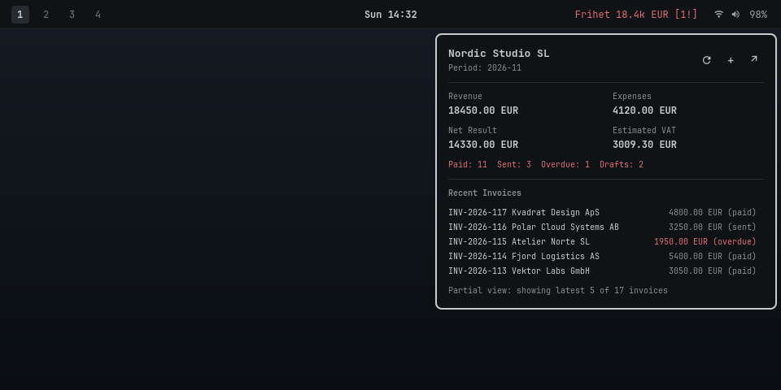

# Frihet ERP for Omarchy

[](https://github.com/Frihet-io/frihet-omarchy/actions/workflows/ci.yml)
[](LICENSE)

Native **Omarchy Quattro** (`omarchy-shell` / Quickshell) bar widget (`io.frihet.erp`) for [Frihet ERP](https://frihet.io). Displays live monthly revenue, overdue invoice alerts, net result, estimated VAT, and your latest 5 invoices directly in the Omarchy bar using active theme colors and typography.



## Installation

Install and enable on Omarchy Quattro:

```bash
omarchy plugin add https://github.com/Frihet-io/frihet-omarchy.git --enable
```

## Configuration

The widget is strictly read-only and reads a single `0600` owner-only credential file at `~/.config/frihet/env`. Create it with an API key from **Frihet ERP -> Settings -> API Keys**:

```bash
mkdir -p -m 700 ~/.config/frihet
(umask 077 && printf 'FRIHET_API_KEY=fri_your_key_here\n' > ~/.config/frihet/env)
```

Right-click the bar pill (or run `omarchy-shell io.frihet.erp refresh`) to load your workspace immediately.

## Controls & Shortcuts

Bar pill:
- **Left-click**: Open or close summary panel
- **Middle-click**: Open `https://app.frihet.io` via `xdg-open`
- **Right-click**: Refresh immediately

Inside open panel:
- **`r`**: Refresh snapshot
- **`n`**: Open `https://app.frihet.io/invoices/new` in browser
- **`o`**: Open `https://app.frihet.io` in browser
- **`Tab` / `Shift+Tab`**: Switch between bar panels
- **`Esc`**: Close panel

Optional Hyprland binding (`~/.config/hypr/bindings.conf`):

```ini
bindd = SUPER SHIFT, B, Frihet Summary, exec, omarchy-shell shell summon io.frihet.erp {}
```

## Dependencies

All runtime tools ship pre-installed in stock Omarchy / Arch Linux:
- `/usr/bin/python3` (Python 3 standard library only; zero third-party packages)
- `/usr/bin/setsid` (`util-linux`) and `/usr/bin/timeout` (`coreutils`)
- `/usr/bin/xdg-open` (`xdg-utils`)

Companion Frihet integrations (optional, separate repositories):
- Official MCP Server: [Frihet-io/frihet-mcp](https://github.com/Frihet-io/frihet-mcp)
- Arch Linux PKGBUILDs & CLI: [Frihet-io/frihet-arch](https://github.com/Frihet-io/frihet-arch)

## Data, Network & Security Boundaries

- **Network endpoints**: Performs read-only HTTPS `GET` requests exclusively to the fixed origin `https://api.frihet.io/v1` (`/context`, `/monthly`, `/invoices?limit=5`). HTTP redirects (`3xx`) and environment proxies are refused, and responses are capped at 256 KiB.
- **Credential handling**: Reads `~/.config/frihet/env` via descriptor-walked `O_NOFOLLOW` checks requiring a regular `0600` file owned by the current UID with link count `1`. Credentials never appear in process `argv` and are redacted in error messages.
- **Filesystem footprint**: This plugin writes **zero files** to disk (no cache files, sockets, background daemons, or shared config edits).
- **UI rendering**: Every QML `Text` item pins `textFormat: Text.PlainText` with bounded width, and strings passed to host bar controls strip `<`, `>`, `&`, control characters, and bidi overrides.

## Removal

Remove the plugin from Omarchy:

```bash
omarchy plugin remove io.frihet.erp
```

What is removed vs kept:
- Deleted by Omarchy: `~/.config/omarchy/plugins/io.frihet.erp` and its bar placement entry.
- Kept (user-created): `~/.config/frihet/env` is not deleted automatically so other Frihet CLI/MCP tools keep working. Delete `~/.config/frihet/env` manually if you no longer need the stored API key.

## Verification

```bash
python3 -m py_compile bin/frihet-omarchy-fetch
node scripts/no-public-leak.mjs
node --test tests/omarchy-suite.test.mjs
```

See [SECURITY.md](SECURITY.md) and [LICENSE](LICENSE) (MIT).
